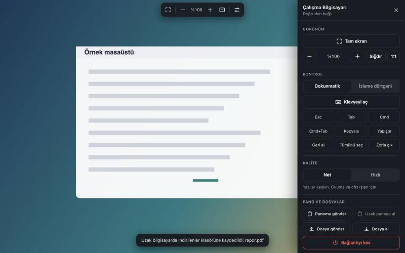
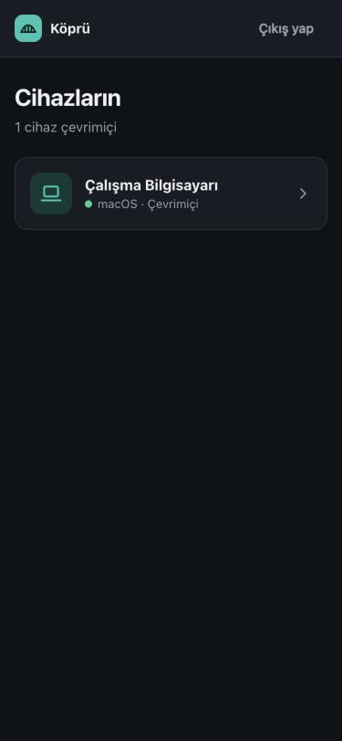
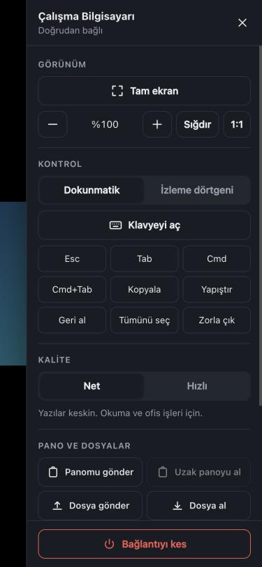
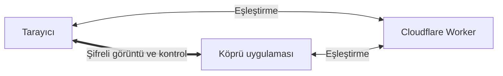

# Köprü

Mac ve Windows bilgisayarlarını telefondan veya başka bir bilgisayardan kontrol etmeni sağlayan, açık kaynaklı kişisel uzak masaüstü. Sunucusu senin kendi Cloudflare hesabında çalışır; merkezi bir hizmete, hesaba veya aboneliğe bağlı değildir.

*English: Köprü ("bridge") is a self-hosted remote desktop. Mac and Windows hosts are controlled from any modern browser, using your own Cloudflare account for connections. The interface and this guide are in Turkish.*



| Cihazlar | Denetimler |
|---|---|
|  |  |

## Özellikler

- Mac ve Windows bilgisayarları kontrol etme
- Mac, Windows ve Android'den tarayıcıyla bağlanma, ek uygulama gerekmez
- Dokunmatik ve izleme dörtgeni modları, sıkıştırarak zoom
- Fiziksel ve ekran klavyesi, hazır tuş kombinasyonları
- Uzak bilgisayarda yazı alanına dokununca telefonda klavyenin otomatik açılması
- Telefon ayarlarından bağımsız ekran yönü: otomatik, dikey veya yatay
- İki yönlü pano ve dosya aktarımı
- Tam ekran, çoklu monitör seçimi, Net ve Hızlı kalite modları
- Windows bilgisayarlardan ses aktarımı
- WebRTC ile şifreli, mümkünse doğrudan bağlantı

## Nasıl çalışır



Cloudflare cihazları birbirine tanıştırır. Görüntü ve kontrol verisi cihazlar arasında WebRTC ile doğrudan akar. Modemde port açman gerekmez.

## Kurulum

İhtiyacın olanlar: [Node.js 20+](https://nodejs.org/) ve ücretsiz bir [Cloudflare](https://dash.cloudflare.com/sign-up) hesabı.

### 1. Sunucuyu kendi hesabına kur

Bu adımı yalnızca bir kez, herhangi bir bilgisayarda yaparsın.

```bash
git clone https://github.com/tasocuk/kopru.git
```

```bash
cd kopru
```

```bash
npm install
```

```bash
npx wrangler login
```

```bash
npm run setup
```

Komut sonunda üç bilgi yazar: **adres**, **erişim kodu** ve **cihaz anahtarı**. Aynı bilgiler `.secrets` dosyasında da saklanır. Bu dosyayı kimseyle paylaşma, yedeğini şifre yöneticinde tut.

### 2. Kontrol edilecek bilgisayarlara Köprü'yü kur

[Sürümler](https://github.com/tasocuk/kopru/releases) sayfasından kendi sistemine uygun dosyayı indir.

**Windows**

1. `Kopru-x.y.z.exe` dosyasını çalıştır.
2. Windows uyarı gösterirse **Ek bilgi**, ardından **Yine de çalıştır** seç. Uygulama imzasız olduğu için bu uyarı normaldir.

**Mac (Apple Silicon)**

1. Zip dosyasını aç, uygulamayı **Uygulamalar** klasörüne taşı.
2. İmzasız uygulama açılmazsa şu komutu çalıştır:

   ```bash
   xattr -cr /Applications/Kopru.app
   ```

3. **Sistem Ayarları > Gizlilik ve Güvenlik** altından Köprü için **Ekran Kaydı** ve **Erişilebilirlik** izinlerini aç.
4. Uygulamayı yeniden başlat.

İlk açılışta adresi, cihaz anahtarını ve bir cihaz adı gir. Bilgisayar birkaç saniye içinde çevrimiçi olur.

### 3. Bağlan

Telefondan veya başka bir bilgisayardan kurulumda verilen adresi aç, erişim kodunu gir ve cihazını seç. Android'de Chrome menüsünden **Ana ekrana ekle** dersen uygulama gibi açılır.

## Kısıtlı ağlar için TURN (isteğe bağlı)

Bazı mobil ve kurumsal ağlarda cihazlar doğrudan bağlanamaz. Bu durumda bağlantı **Cihazla bağlantı kurulamadı** hatası verir. Çözmek için:

1. Cloudflare panelinde **Realtime > TURN** bölümünden anahtar oluştur.
2. Anahtar bilgileriyle kurulumu yeniden çalıştır:

   ```bash
   TURN_KEY_ID=anahtar_id TURN_KEY_API_TOKEN=anahtar_token npm run setup
   ```

TURN verisi Cloudflare üzerinden geçer ama uçtan uca şifreli kalır. Ücret ve kota için [Cloudflare TURN belgelerine](https://developers.cloudflare.com/realtime/turn/faq/) bak.

## Kullanım

| Dokunma | İşlem |
|---|---|
| Dokun | Sol tık |
| Basılı tut veya iki parmakla dokun | Sağ tık |
| Tek parmakla sürükle | Sürükleme, izleme dörtgeni modunda imleç |
| Sağ kenardaki klavye düğmesi | Klavyeyi aç veya kapat |
| Sağ kenardaki döndürme düğmesi | Ekranı dikey ve yatay arasında çevir |
| Sıkıştır | Zoom |
| İki parmakla sürükle | Yakınlaştırılmışken görünümü, değilse uzak ekranı kaydır |

| Kısayol | İşlem |
|---|---|
| `Ctrl+Alt+F` | Tam ekran |
| `Ctrl+Alt+=` ve `Ctrl+Alt+-` | Zoom |
| `Ctrl+Alt+0` | Ekrana sığdır |
| `Ctrl` + tekerlek veya trackpad sıkıştırma | İmlecin olduğu yere zoom |

Mac'te `Alt` yerine `Option` kullan.

## Güvenlik

- Erişim kodunu bilen herkes bilgisayarlarını kontrol edebilir. Kodu paylaşma ve şifre yöneticisinde sakla.
- Cihaz anahtarı yalnızca Köprü uygulamasına girilir. Sızdıysa `.secrets` dosyasından satırı silip `npm run setup` çalıştır, sonra cihazlara yeni anahtarı gir.
- Aynı IP'den 10 hatalı denemeden sonra giriş 10 dakika kilitlenir.
- Görüntü ve kontrol WebRTC ile şifrelenir. Eşleştirme kendi Worker'ın üzerinden geçer, bu yüzden Cloudflare hesabını da iki adımlı doğrulamayla koru.
- Yazılım herhangi bir garanti olmadan sunulur. Bağımsız bir güvenlik denetiminden geçmemiştir.

## Bilinen sınırlar

- Windows giriş ekranı, UAC pencereleri ve `Ctrl+Alt+Del` desteklenmez.
- Mac'te kilit ekranındaki kontrol sınırlıdır ve Mac'ten ses aktarılmaz.
- Bilgisayar uykudayken bağlanılamaz. Köprü'nün açık kalması gerekir.
- Mac sürümü yalnızca Apple Silicon için derlenir. Uygulamalar imzasızdır.
- Otomatik klavye, yazı alanını erişilebilirlik bilgisinden anlar. Bazı uygulamalar bu bilgiyi vermez; o zaman klavye düğmesini kullan.
- Ekran yönü kilidi tam ekran gerektirir ve iPhone Safari'de çalışmaz.

## Geliştirme

```bash
npm start
```

```bash
npm test
```

```bash
npm run build:mac
```

Windows sürümünü Mac'te derlemek için önce Windows modülünü ekle:

```bash
npm install --no-save --force @nut-tree-fork/libnut-win32
```

```bash
npm run build:win
```

| Klasör | İçerik |
|---|---|
| `client/` | Tarayıcı arayüzü |
| `src/` | Mac ve Windows için Electron uygulaması |
| `worker/` | Cloudflare Worker ve eşleştirme |
| `native/` | Mac'te yazı alanı algılama yardımcısı |
| `scripts/` | Kurulum aracı |

## Lisans

[MIT](LICENSE)
